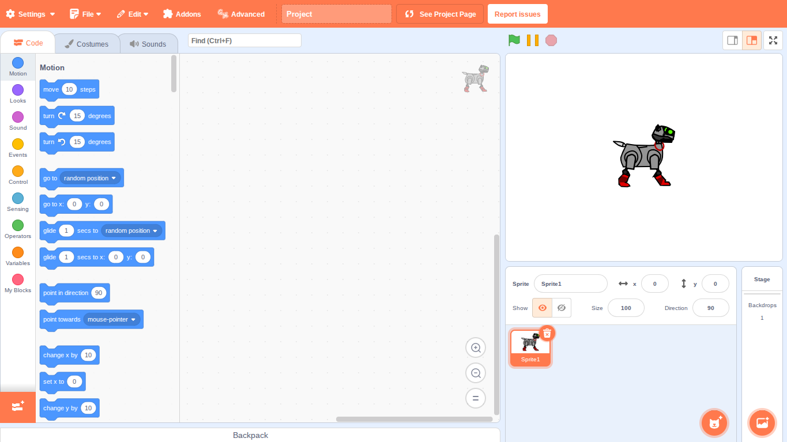

# Gvbvdxx Mod 2 [Updated] GUI



An updated version of the Gvbvdxx Mod 2 editor, based on TurboWarp's editor.

Gvbvdxx Mod 2 is a tool for making programs in your browser by connecting lego-like blocks toghether (also known as block-coding and block-based-coding). Gvbvdxx Mod 2 is a modification of [TurboWarp's](https://turbowarp.org/) code, which in turn is a modification of [Scratch's](https://scratch.mit.edu/) code. Gvbvdxx Mod 2 aims for more power and control over what you can make with it, compared to [Scratch](https://scratch.mit.edu/). Additionally since Gvbvdxx Mod 2 is based on [TurboWarp's](https://turbowarp.org/) code, it also inherits its super fast compiler, making it easier to make larger programs for slower devices compared to raw Scratch.


Heavily edited to work best with the GvbvdxxMod2 vm.
Based on a modified version of TurboWarp, which is also a modified version of Scratch.

# Minimal Requirements

Node JS (Latest should work)
NPM
Git (If you want to use command line for cloning)

# Installation
```
npm install
```
or
```
yarn install
```

# Devlopment Server

```
npm run start
```
or
```
yarn start
```

# Build

```
npm run build
```
or
```
yarn build
```